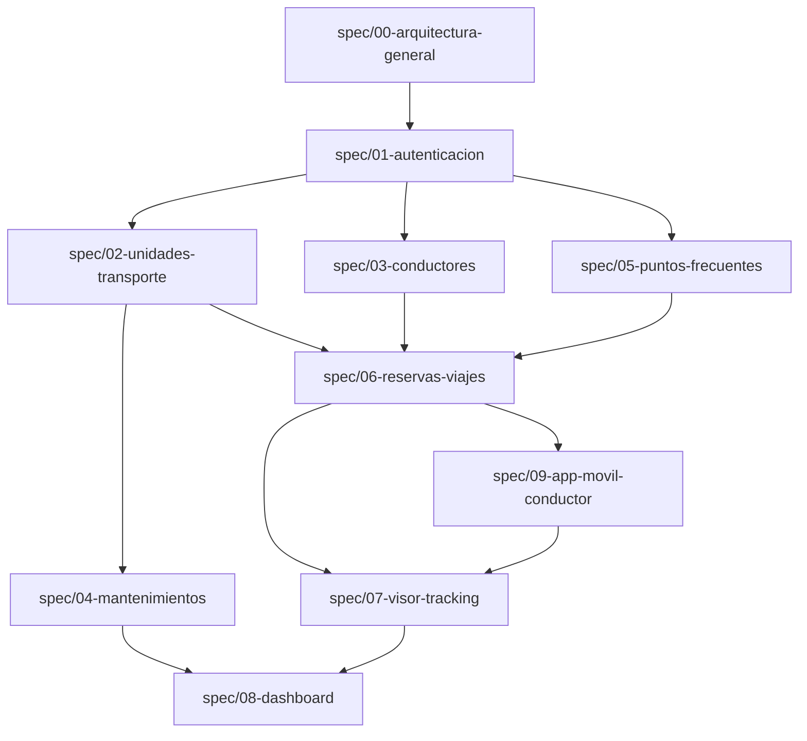

# PLAN.md — Plan de Implementación Basado en Especificaciones (SDD)

Este plan de implementación sigue la estrategia **Spec-Driven Development (SDD)**. Cada fase construye de manera incremental los módulos definidos en la carpeta `spec/` y mantiene trazabilidad directa hacia sus criterios de aceptación.

---

## Mapa de Dependencias entre Módulos (`spec/`)

---

## Fase 1: Cimientos del Monorepo, Base de Datos, Seed y Autenticación
**Specs Asociados:**
- [`spec/00-arquitectura-general/SPEC.md`](file:///h:/Repos/GestionUnidadesTransporte/spec/00-arquitectura-general/SPEC.md)
- [`spec/01-autenticacion/SPEC.md`](file:///h:/Repos/GestionUnidadesTransporte/spec/01-autenticacion/SPEC.md)

### Tareas:
1. **Estructura Base y Docker (`spec/00`):**
   - Inicializar `apps/backend` (NestJS + TypeScript) y `apps/web` (Next.js App Router + TailwindCSS + `shadcn/ui` + `@tanstack/react-table`).
   - Configurar conexión `@nestjs/mongoose` compatible con Azure CosmosDB para MongoDB y variables `.env.example`.
   - Configurar Swagger (`/api/docs`), `ValidationPipe` global, filtro estándar de excepciones HTTP y CORS.
   - Crear `docker-compose.yml` en la raíz con contenedores `mongodb`, `backend` y `web`.
2. **Autenticación Dual y Seed (`spec/01`):**
   - Implementar esquema `UsuarioAdmin` y servicio de `SeedService` (creación idempotente de Admin por defecto + catálogo base del checklist de mantenimiento).
   - Implementar `JwtStrategy`, `JwtAuthGuard` y `RolesGuard` (`ADMIN` y `CONDUCTOR`).
   - Crear endpoints `POST /api/v1/auth/admin/login`, `POST /api/v1/auth/conductor/login` y `GET /api/v1/auth/me`.
   - Implementar en `apps/web` la pantalla `/login`, almacenamiento de sesión JWT, layout administrativo con navegación lateral y protección de rutas.

### Entregable y Verificación de Fase 1:
- Levantar `docker compose up --build`, verificar Swagger en `http://localhost:10102/api/docs` e iniciar sesión en `http://localhost:10101/login` (contenedores expuestos en el rango de puertos `10101 - 10109`).

---

## Fase 2: Catálogos Base de Flota (Unidades de Transporte, Conductores y Puntos Frecuentes)
**Specs Asociados:**
- [`spec/02-unidades-transporte/SPEC.md`](file:///h:/Repos/GestionUnidadesTransporte/spec/02-unidades-transporte/SPEC.md)
- [`spec/03-conductores/SPEC.md`](file:///h:/Repos/GestionUnidadesTransporte/spec/03-conductores/SPEC.md)
- [`spec/05-puntos-frecuentes/SPEC.md`](file:///h:/Repos/GestionUnidadesTransporte/spec/05-puntos-frecuentes/SPEC.md)

### Tareas:
1. **Módulo de Unidades de Transporte (`spec/02`):**
   - Backend: Esquema `UnidadTransporte`, validaciones de placa única, tipos de UT (`CAMION`, `SEDAN`, `CAMIONETA_SUV`, `CAMIONETA_PICKUP`, `VAN`, `MOTO`) y bloqueo de cambio manual de estado si la UT está en `VIAJANDO` o `EN_MANTENIMIENTO`.
   - Web (`/unidades-transporte`): Tabla con `@tanstack/react-table` (filtros por estado y tipo, buscador, paginación) y modal de creación/edición con bloqueo visual del campo estado cuando corresponda.
2. **Módulo de Conductores (`spec/03`):**
   - Backend: Esquema `Conductor` con índice único en `cedula` y endpoints CRUD (`/api/v1/conductores`).
   - Web (`/conductores`): Tabla con `@tanstack/react-table` y modal de registro/edición de conductores (`nombre`, `apellido`, `cedula`, `telefono`, `activo`).
3. **Módulo de Puntos Frecuentes (`spec/05`):**
   - Backend: Esquema `PuntoFrecuente` (`nombre`, `direccion`, `coordenadas { lat, lng }`) y endpoints CRUD (`/api/v1/puntos-frecuentes`).
   - Web (`/puntos-frecuentes`): Vista dividida con listado en TanStack Table e integración de **Google Maps** para marcar puntos en el mapa, obtener dirección por Reverse Geocoding y guardarlos como puntos frecuentes.

### Entregable y Verificación de Fase 2:
- Registrar UTs, Conductores y Puntos Frecuentes desde la Web y verificar todas las validaciones de estado y unicidad.

---

## Fase 3: Gestión de Mantenimientos y Reserva de Viajes
**Specs Asociados:**
- [`spec/04-mantenimientos/SPEC.md`](file:///h:/Repos/GestionUnidadesTransporte/spec/04-mantenimientos/SPEC.md)
- [`spec/06-reservas-viajes/SPEC.md`](file:///h:/Repos/GestionUnidadesTransporte/spec/06-reservas-viajes/SPEC.md)

### Tareas:
1. **Módulo de Reserva de Viajes (`spec/06`):**
   - Backend: Esquema `ReservaViaje` y endpoints para crear, listar, reasignar y cancelar reservas, validando que la UT esté en estado `DISPONIBLE` o `VIAJANDO` (nunca `EN_MANTENIMIENTO` ni `INACTIVA`).
   - Web (`/reservas-viajes`): Listado de reservas y formulario con mapa interactivo de Google Maps que permite elegir **Origen** y **Destino** (combinando Puntos Frecuentes o selección directa en mapa), trazando la ruta y calculando automáticamente los **kilómetros sugeridos por Google Maps** (`kmSugeridosGoogle`).
2. **Módulo de Mantenimientos (`spec/04`):**
   - Backend: Esquemas `CatalogoTareaMantenimiento` y `Mantenimiento`. Endpoints para abrir mantenimiento en estado `BORRADOR` (cambiando la UT a `EN_MANTENIMIENTO`), actualizar tareas del checklist base + tareas manuales, gestionar reservas pendientes afectadas (cancelar o reasignar) y finalizar el mantenimiento registrando `observacionesPersonal` y pasando la UT a `DISPONIBLE` o `INACTIVA`.
   - Web (`/mantenimientos`): Vista de mantenimientos en borrador e historial, formulario con checklist base + adición dinámica de tareas manuales, alerta de reservas pendientes y modal de cierre de mantenimiento con selección del estado final de la UT.

### Entregable y Verificación de Fase 3:
- Crear reservas calculando el kilometraje sugerido con Google Maps; enviar una UT a mantenimiento en borrador verificando que cambia a `EN_MANTENIMIENTO`, y finalizar el mantenimiento dejándola `DISPONIBLE` o `INACTIVA`.

---

## Fase 4: Telemetría Backend, Visor de Unidades de Transporte y Dashboard
**Specs Asociados:**
- [`spec/07-visor-tracking/SPEC.md`](file:///h:/Repos/GestionUnidadesTransporte/spec/07-visor-tracking/SPEC.md)
- [`spec/08-dashboard/SPEC.md`](file:///h:/Repos/GestionUnidadesTransporte/spec/08-dashboard/SPEC.md)

### Tareas:
1. **Endpoints de Ciclo de Viaje y Tracking (`spec/07`):**
   - Backend: Esquema `PuntoTrackingViaje` con índice de idempotencia `idPuntoCliente`.
   - Implementar `POST /api/v1/viajes/:viajeId/iniciar` (cambia reserva a `EN_CURSO` y UT a `VIAJANDO`).
   - Implementar `POST /api/v1/viajes/:viajeId/tracking/batch` (recepción de lotes de coordenadas y velocidades cada 5 minutos).
   - Implementar `POST /api/v1/viajes/:viajeId/finalizar` (cálculo de distancia real GPS por Haversine, incremento automático del `kilometraje` de la UT, detección de exceso de kilometraje `>10%`, cambio de viaje a `FINALIZADO` y UT a `DISPONIBLE`).
   - Implementar endpoints de consulta del visor (`/api/v1/visor/activos`, `/api/v1/visor/viajes`, `/api/v1/visor/viajes/:id/tracking`, `/api/v1/visor/viajes/:id/justificacion`).
2. **Visor Web e Historial de Viajes (`spec/07`):**
   - Web (`/visor`): Mapa de UTs activas con auto-refresco cada 30s mostrando ubicación actual, velocidad y ruta recorrida; buscador de historial de viajes (activos y terminados) con comparativa visual de Ruta Sugerida vs. Ruta Real GPS y formulario para registrar justificaciones por exceso de kilometraje.
3. **Dashboard y KPIs (`spec/08`):**
   - Backend: Endpoint `GET /api/v1/dashboard/resumen`.
   - Web (`/dashboard`): Tarjetas con los 4 KPIs principales (`UTs Disponibles`, `UTs Viajando`, `UTs en Mantenimiento`, `UTs Inactivas`), resumen de viajes del día y panel de alertas de desviación de kilometraje y unidades en taller.

### Entregable y Verificación de Fase 4:
- Simular desde Swagger el inicio de un viaje, el envío de lotes de coordenadas y el cierre del viaje, comprobando que el Visor Web dibuja la ruta, suma el kilometraje a la UT y actualiza los KPIs del Dashboard.

---

## Fase 5: Aplicación Móvil Android para Conductores
**Specs Asociados:**
- [`spec/09-app-movil-conductor/SPEC.md`](file:///h:/Repos/GestionUnidadesTransporte/spec/09-app-movil-conductor/SPEC.md)
- [`spec/01-autenticacion/SPEC.md`](file:///h:/Repos/GestionUnidadesTransporte/spec/01-autenticacion/SPEC.md)

### Tareas:
1. **Proyecto Base Android (`apps/mobile`):**
   - Configurar proyecto Gradle Kotlin (`minSdk = 34`, Android 14+), Jetpack Compose (Material 3), Hilt, Retrofit + OkHttp (con interceptor JWT Bearer), Room Database y Google Maps Compose SDK.
2. **Pantalla de Ingreso y Reservas del Día (`LoginReservasScreen` + `LoginReservasViewModel`):**
   - Ingreso por `cédula` y `placa` de la UT, búsqueda de reservas del día actual (sin bloquear por hora de inicio) y botón **"Iniciar Viaje"**.
3. **Servicio en Segundo Plano y Sincronización Offline-First (`TrackingForegroundService` + Room):**
   - Configurar permisos de ubicación en primer y segundo plano (`FOREGROUND_SERVICE_LOCATION`).
   - Capturar coordenadas (`lat`, `lng`) y velocidad (`km/h`) cada 10s / 15m guardándolas en Room (`puntos_tracking_locales`).
   - Implementar sincronizador en lotes cada **5 minutos** hacia `/api/v1/viajes/:id/tracking/batch` con almacenamiento persistente en Room; si no encuentra conexión con la API, espera a restablecer comunicación para enviar los lotes acumulados.
4. **Pantalla de Viaje Activo (`ViajeActivoScreen` + `ViajeActivoViewModel`):**
   - Componente de **Velocímetro en tiempo real (`km/h`)** en Jetpack Compose.
   - Componente `GoogleMap` mostrando posición actual de la UT, marcadores de Origen/Destino, ruta sugerida y polilínea de la ruta recorrida en tiempo real.
   - Botón **"Terminar Viaje"** que envía el lote pendiente final, cierra el viaje en el backend y detiene el servicio en segundo plano.

### Entregable y Verificación de Fase 5:
- Prueba integral extremo a extremo (Web + Backend en Docker + App Android en emulador/dispositivo Android 14+): crear reserva en Web, iniciar viaje en Android, verificar tracking en segundo plano y lote cada 5 min en el Visor Web, y terminar el viaje verificando la actualización automática del kilometraje de la UT.
